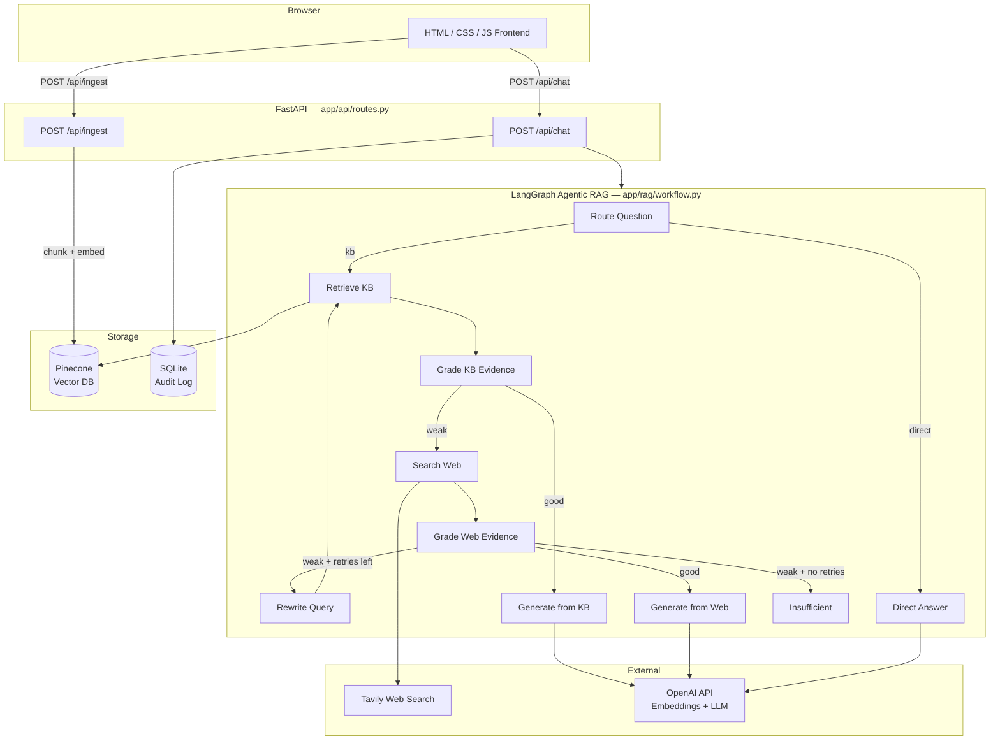
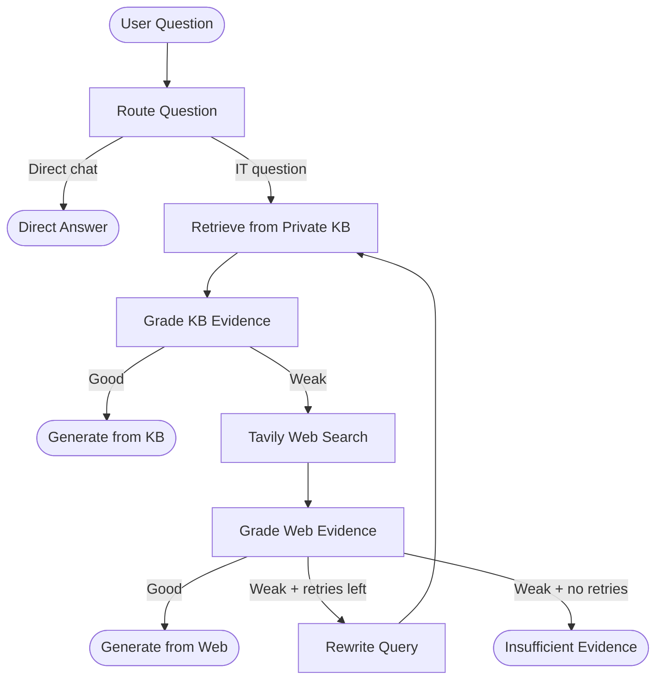

# RAGShield — Enterprise IT Support Copilot

An agentic RAG system that handles internal IT support queries. It searches the company's private knowledge base first, falls back to web search when private evidence is insufficient, rewrites weak queries and retries, and explains every decision it made to get to the answer.


---

## Architecture



---

## How the RAG workflow runs



Every response includes a `trace` field showing the exact path the agent took — which nodes ran, what grades were assigned, and which source was used to generate the answer.

---

## Tech stack

| Layer | Technology |
|-------|-----------|
| Agent workflow | LangGraph |
| LLM | Groq — LLaMA 3.3 70B |
| Embeddings | HuggingFace all-MiniLM-L6-v2 (runs locally, free) |
| Vector database | Pinecone |
| Web search | Tavily |
| API | FastAPI |
| Frontend | HTML / CSS / JavaScript |
| Audit log | SQLite |
| Container | Docker |

---

## Project structure

```
ragshield/
├── app/
│   ├── api/
│   │   └── routes.py           chat, ingest, health endpoints
│   ├── core/
│   │   ├── config.py           settings and env vars
│   │   └── logging.py          logging setup
│   ├── rag/
│   │   ├── state.py            LangGraph state and Pydantic models
│   │   ├── vectorstore.py      Pinecone + embeddings
│   │   └── workflow.py         full agentic RAG graph
│   ├── services/
│   │   ├── audit.py            SQLite query audit
│   │   └── ingestion.py        PDF/TXT/MD/DOCX loading and chunking
│   └── main.py                 FastAPI app
├── data/
│   └── sample_kb/              sample company knowledge base documents
├── static/
│   ├── css/style.css
│   └── js/app.js
├── templates/
│   └── index.html
├── uploads/                    uploaded documents stored here
├── .env.example
├── Dockerfile
├── ingest_sample_kb.py         load sample KB into Pinecone
├── requirements.txt
└── run.py                      local dev server
```

---

## Setup

### 1. Clone and create a virtual environment

```bash
git clone https://github.com/YadavAkhileshh/RAGShield.git
cd RAGShield
python -m venv venv
venv\Scripts\activate        # Windows
source venv/bin/activate     # macOS / Linux
```

### 2. Install dependencies

```bash
pip install -r requirements.txt
```

### 3. Set up `.env`

```bash
cp .env.example .env
```

Fill in your keys. You need Groq, Tavily, and Pinecone. Embeddings run locally via HuggingFace — no API key needed.

### 4. Load the sample knowledge base

```bash
python ingest_sample_kb.py
```

This chunks the documents in `data/sample_kb/` and indexes them in Pinecone.

### 5. Run the app

```bash
python run.py
```

Open `http://localhost:8000`. API docs at `http://localhost:8000/docs`.

---

## Docker

```bash
docker build -t ragshield .
docker run -p 8000:8000 --env-file .env ragshield
```

---

## API

**GET** `/api/health` — health check

**POST** `/api/chat`
```json
{ "question": "How do I connect to the company VPN from home?" }
```
Response:
```json
{
  "answer": "...",
  "source_used": "private_kb",
  "trace": ["Router → KB", "Private KB retrieval → 4 chunks", "KB evidence grade → GOOD", "Answer generation → PRIVATE KB"],
  "citations": []
}
```

**POST** `/api/ingest` — upload a document (`.pdf`, `.txt`, `.md`, `.docx`)
Requires `X-Admin-Key` header matching `ADMIN_API_KEY` in `.env`.

---

## API keys

| Service | Link |
|---------|------|
| Groq | https://console.groq.com |
| Tavily | https://tavily.com |
| Pinecone | https://pinecone.io |

---

## License

MIT
